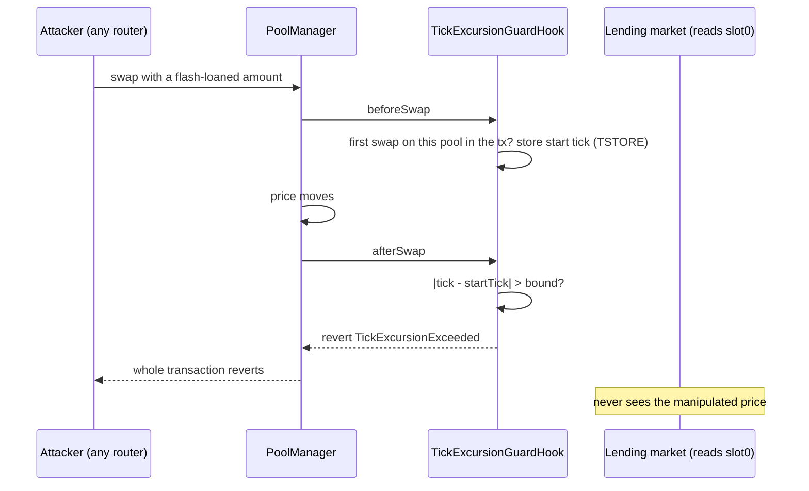

# v4-guard

[](https://github.com/primac23/v4-guard/actions/workflows/test.yml)

Security primitives for Uniswap v4 hooks, built on EIP-1153 transient storage.

**In a reproducible test it blocks a flash-loan oracle attack that earns 0.59 token1 per 1 token1 borrowed on an unprotected pool, an attack the closest existing halt-based hook lets through unchanged.** It ships as a standalone hook and as a base contract that existing hooks can inherit.

The main component is `TickExcursionGuardHook`, a hook that limits how far a pool's price can move inside a single transaction. It is checked after every swap, so the caller cannot skip it, and it reverts the transaction as soon as the tick drifts more than a configured number of ticks away from where it started.

## Why

Plenty of protocols still read a pool's spot price directly. The usual way to attack them is a flash-loan round trip: push the price, use the distorted price somewhere else, push it back, repay. The net flow of such a transaction is close to zero, so checks based on volume or balances don't notice anything. What gives it away is the price excursion in the middle, and that is exactly what this hook bounds.

## How it works



## Proof of concept

A flash-loan attack on a lending market that prices collateral from `slot0` turns a 1 token1 loan into 0.5928 token1 of profit and leaves 1.0936 token1 of bad debt when the pool has no hook. On the same pool with `TickExcursionGuardHook`, the attack reverts. Setup, numbers and limits: [docs/POC_FLASHLOAN_ORACLE.md](docs/POC_FLASHLOAN_ORACLE.md).

## Components

| Contract | What it does | Status |
|---|---|---|
| `TickExcursionGuardHook` | Records the pool tick before the first swap of a transaction (transient storage) and reverts any swap that leaves the tick more than `MAX_TICK_DEVIATION` away from it. | Tested on the real v4 PoolManager |
| `TickExcursionGuard` | Abstract base with the same check as internal functions, so an existing hook can add the protection to its own callbacks. A pool can only have one hook, so this is how the guard combines with other logic. | Tested through an example composed hook |
| `TransientReentrancyGuard` | Transaction-scoped reentrancy lock using TSTORE/TLOAD. Same behaviour as OpenZeppelin's `ReentrancyGuardTransient`; kept as a small self-contained utility. | Unit tested |
| `ImbalanceGateHook` | Accumulates per-pool swap deltas and exposes `validateSettlementInvariant`. The check only runs if the router calls it, so it works as a cooperative volume limit for trusted routers, not as a defence against an attacker. | Experimental |

## What TickExcursionGuardHook guarantees

For every pool, after every swap in a transaction: `|tick - startTick| <= MAX_TICK_DEVIATION`, where `startTick` is the tick before the first swap on that pool in the transaction.

- Enforced in `beforeSwap`/`afterSwap`, which the PoolManager always calls. No cooperation from the router is needed.
- Holds after every swap, not only at the end, so an out-and-back manipulation reverts at the first swap that crosses the bound.
- State is keyed by pool id and disappears at the end of the transaction.

Not covered: manipulation split across several transactions or blocks (hooks with a per-block reference cover that case, see Related work), moves that stay within the bound, and depth changes through liquidity add/remove. All swaps on a pool in one transaction share the same budget, which matters for batched settlement. Details in [docs/THREAT_MODEL.md](docs/THREAT_MODEL.md).

## Related work

Bounding price movement from a hook is not a new idea. The closest projects I know of:

- [nirholas/circuit-breaker](https://github.com/nirholas/circuit-breaker) compares the tick with a reference window after every swap and halts swapping for a cooldown once the limit is crossed. The swap that crosses the limit is allowed to complete, by design. Run against the same single-transaction PoC with the same 50-tick bound, the attack still succeeds with exactly the same profit as on an unhooked pool (0.5928 token1 on a 1 token1 loan), and the pool halts only afterwards, locking out honest traders for the cooldown ([details](docs/COMPARISON_CIRCUIT_BREAKER.md)).
- [FairOpenHook](https://github.com/n0krayy/FairOpenHook) reverts swaps that move the price more than 25% during a token's opening window.
- [CrossPoolOracleHook](https://github.com/pnupu/crosspooloraclehook) compares a pool's price impact with deep reference pools and blocks swaps whose impact the reference pools don't explain.
- Uniswap's [Truncated Oracle](https://blog.uniswap.org/uniswap-v4-truncated-oracle-hook) caps how far the recorded oracle tick can move per block. It does not block swaps.
- OpenZeppelin's [AntiSandwichHook](https://docs.openzeppelin.com/uniswap-hooks) uses a beginning-of-block checkpoint so that no swap fills at a better price than the block started with.

Where v4-guard differs: the check is scoped to a single transaction and reverts the swap that crosses the bound, instead of letting it through and reacting afterwards. That matters for single-transaction attacks like the PoC above, where the attacker never needs to move the price back. The hook also keeps no persistent state and has no owner, so it can't be used to halt a pool for other traders. The trade-off is that manipulation spread over several transactions in a block is not covered.

### At a glance

Both columns come from tests in this repository, run with the same 50-tick bound.

| | v4-guard | circuit-breaker |
|---|---|---|
| Single-transaction oracle attack (our PoC) | reverts | succeeds, same profit as with no hook |
| Manipulation spread over several transactions | not covered | covered by the window and halt |
| Honest traders after an attack | unaffected | halted for the cooldown |
| Configuration | immutable per deployment, nothing to configure | per pool, set before initialization |
| Persistent storage | none | yes |
| Packaged for use inside another hook | yes, `TickExcursionGuard` base contract | standalone hook, not built as a base |

## Gas

Measured on the real PoolManager with identical pools, with and without the hook. A single swap costs 11,632 gas more (7.8% of the swap call). Full table and method in [docs/BENCHMARKS.md](docs/BENCHMARKS.md).

## Usage

```bash
forge install primac23/v4-guard
```

The hook must be deployed at an address whose low bits encode `BEFORE_SWAP` and `AFTER_SWAP` (mine the salt with `HookMiner` from v4-periphery). The constructor checks the permissions.

```solidity
// ±50 ticks is roughly ±0.5% price movement within one transaction
TickExcursionGuardHook hook = new TickExcursionGuardHook{salt: salt}(poolManager, 50);
```

## Adding the guard to your own hook

A pool can only have one hook. If you already have one, inherit `TickExcursionGuard` and call it from your callbacks:

```solidity
contract MyHook is BaseHook, TickExcursionGuard {
    uint24 public immutable MAX_TICK_DEVIATION = 50;

    function beforeSwap(address, PoolKey calldata key, SwapParams calldata, bytes calldata)
        external override onlyPoolManager returns (bytes4, BeforeSwapDelta, uint24)
    {
        _recordStartTick(poolManager, key.toId()); // first
        // ... your logic
        return (this.beforeSwap.selector, BeforeSwapDeltaLibrary.ZERO_DELTA, 0);
    }

    function afterSwap(address, PoolKey calldata key, SwapParams calldata, BalanceDelta, bytes calldata)
        external override onlyPoolManager returns (bytes4, int128)
    {
        // ... your logic
        _enforceTickExcursion(poolManager, key.toId(), MAX_TICK_DEVIATION); // last
        return (this.afterSwap.selector, 0);
    }
}
```

`test/ComposedGuard.t.sol` shows a hook with its own state using it: normal swaps run the hook's logic, and a manipulating swap reverts together with that state.

## Tests

```bash
forge test -vv
forge test --match-contract GasBenchmarkV2Test -vv
```

29 tests passing.

## Documentation

- [docs/THREAT_MODEL.md](docs/THREAT_MODEL.md)
- [docs/INVARIANTS.md](docs/INVARIANTS.md)
- [docs/BENCHMARKS.md](docs/BENCHMARKS.md)
- [docs/POC_FLASHLOAN_ORACLE.md](docs/POC_FLASHLOAN_ORACLE.md)
- [docs/COMPARISON_CIRCUIT_BREAKER.md](docs/COMPARISON_CIRCUIT_BREAKER.md)

## License

MIT
